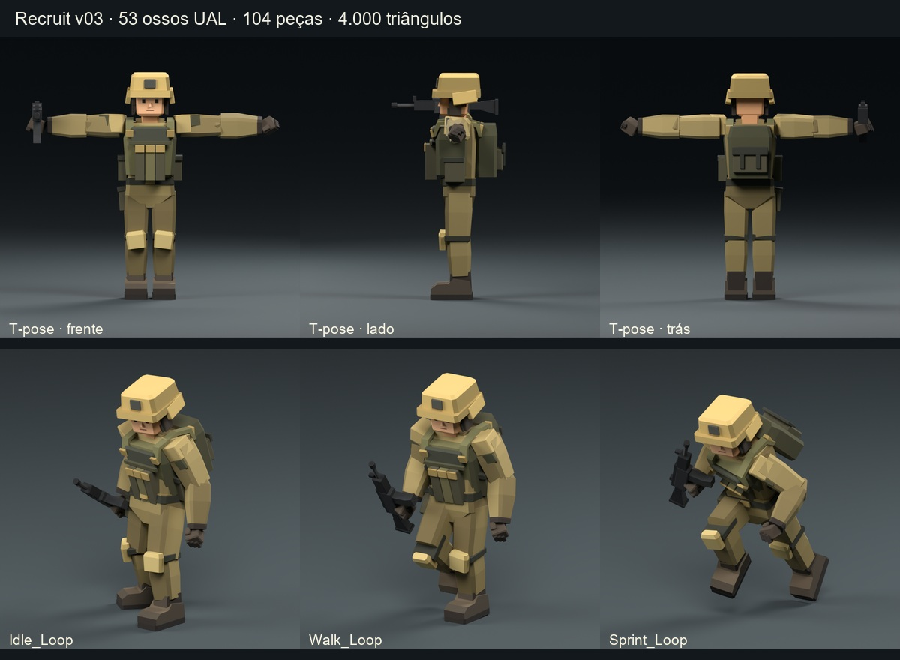
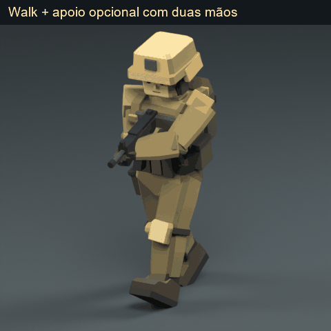

# Recruit v03 — rig UAL e validação

Entregue com **53 ossos e hierarquia idênticos ao JSON**, 104 peças rígidas separadas, 4.000 triângulos e os mesmos 35 materiais. O GLB principal contém **zero animações e zero texturas**. Os ficheiros de origem foram preservados e conferidos por SHA-256.

## Resultado e dimensão

- Altura real preservada: **2,025 m**, normalmente apresentada como 2,03 m. O GLB fornecido já media 2,025 m; não foi aumentado para 2,030 m.
- Pés na pose base: Y = 0 dentro da precisão de ponto flutuante (erro máximo de 0,000001 m). Unidades: metros; vertical +Y; frente -Z; origem inalterada.
- Pose base: **T-pose**, verificada na biblioteca real e no clip `A_TPose`. As peças dos braços e pernas foram reposicionadas rigidamente, sem alterar a sua malha ou paleta.
- Cada vértice tem uma única influência de peso 1,0; cada peça inteira usa um único osso. As 104 peças e os seus nomes continuam independentes.
- `Muzzle` está na ponta do cano, ligado a `DEF-hand.R`. O eixo local **-Z** do nó segue o disparo; não acrescenta um 54.º osso.

## Compatibilidade com as animações fornecidas

Ter os mesmos nomes e pais é necessário, mas não basta para reutilizar sem alterações todos os canais absolutos de posição: esses canais substituem os offsets da pose base e podem recolocar as articulações nas proporções originais da biblioteca. Por isso, entrego também **`Recruit_UAL_compatible.tres`**, uma biblioteca externa com os 46 clips adaptados automaticamente às posições deste rig, e um carregador sem mapeamento manual. A biblioteca original permanece intacta. O GLB principal continua sem animações.

Esta é uma adaptação automática dos dados da biblioteca; não se afirma que a biblioteca bruta, aplicada sem essa adaptação, preserve as novas proporções. O gerador `recruit_v03_work/godot_validation/validate_ual.gd` conserva os nomes, durações e rotações de movimento, rebaseia posições sobre os novos rests e aplica fator 1.090698997 ao movimento de hips/root. Os eixos locais dos ossos foram copiados da biblioteca.

O JSON declara frente -Z, mas as coordenadas dos dedos dos pés e a biblioteca real apontam para +Z. Foi usada uma rotação fixa de 180° no contentor do rig, mantendo as orientações locais originais e a frente -Z do Recruit. Não remova essa rotação do contentor `Rig` ao importar.

A biblioteca contém `Idle_Loop`, `Walk_Loop` e **`Sprint_Loop`**; não existe um clip com o nome `Run`. As imagens/GIFs `Run_Sprint` usam `Sprint_Loop`.

Referência técnica: [Godot — retargeting de esqueletos 3D](https://docs.godotengine.org/en/stable/tutorials/assets_pipeline/retargeting_3d_skeletons.html). Origem da biblioteca: [Quaternius — Universal Animation Library](https://quaternius.com/packs/universalanimationlibrary.html), CC0.

## Utilização no Godot

**Caminho pronto:** copie `Recruit_v03.tscn`, o GLB, a biblioteca `.tres`, os dois scripts `.gd` e o JSON de empunhadura para a mesma pasta do projeto. Instancie `Recruit_v03.tscn` na cena do jogo: já tem a biblioteca atribuída e o apoio de duas mãos ativo. Esta cena foi importada pelo editor e executada no Godot 4.7.2, iniciando Idle corretamente. É um contentor do personagem para integrar na sua cena, sem câmara nem controlador de movimento.

Para integrar diretamente o GLB numa cena existente:

1. Copie o GLB, `Recruit_UAL_compatible.tres`, `Recruit_UAL_loader.gd`, `Recruit_Rifle_Hold.gd` e `Recruit_Rifle_Hold_pose.json` para a mesma pasta do projeto.
2. Instancie o GLB numa cena editável e associe `Recruit_UAL_loader.gd` ao nó raiz dessa instância, ou a um filho desse nó.
3. No campo `animation_library`, escolha `Recruit_UAL_compatible.tres`. O carregador encontra o Skeleton3D e inicia `UAL/Idle_Loop`. Se a cena contiver vários esqueletos, preencha `skeleton_path` para selecionar explicitamente o do Recruit.
4. Ative `use_rifle_hold` para manter as duas mãos na arma durante a locomoção. Para mudar de clip, chame `play_ual("Walk_Loop")` ou `play_ual("Sprint_Loop")` no carregador.

O carregador cria o AnimationPlayer como filho de Skeleton3D, com `root_node = ".."`; os canais da biblioteca externa usam `.:nome_do_osso`. Isto evita diferenças de caminhos entre cenas. Validação executada no Godot **4.7.2**. O modificador opcional usa a API `SkeletonModifier3D`; versões antigas de Godot 4 que não disponham dessa classe exigem atualização ou integração equivalente. O GLB e a biblioteca externa não dependem do modificador para animação normal.

## Arma e apoio da mão esquerda

A arma está ligada rigidamente à mão direita, com cano dirigido para -Z na pose base. Numa T-pose as mãos estão afastadas; por isso, a arma fica junto da mão direita à altura do peito, sem forçar a mão esquerda ao centro e descaracterizar a pose base da biblioteca.

O par `Recruit_Rifle_Hold.gd` + `Recruit_Rifle_Hold_pose.json` fornece uma sobreposição opcional dos oito ossos de ombros/braços/mãos, sem novos ossos e sem animações incorporadas. A imagem `empunhadura_duas_maos.png` mostra essa pose; `Walk_hold.gif` mostra-a sobre Walk. O cano acompanha a inclinação e rotação do tronco; não é um sistema de mira horizontal em espaço global. A pose usa a geometria da espingarda atual. Outras armas podem precisar de novos offsets de pega/apoio.

Todas as peças `Rifle_*` continuam separadas, com peso 1 em `DEF-hand.R`. Para substituir a arma, remova/oculte essas peças e use um BoneAttachment3D em `DEF-hand.R`, com os offsets de pega da nova arma. Preserve ou recrie o seu próprio `Muzzle`. Não foram criados os cinco modelos de armas mencionados para uma fase posterior.

## Validação realizada

| Verificação | Resultado |
|---|---|
| Blender | 5.2.2 LTS |
| Godot real | 4.7.2-stable (official) |
| Nomes/pais dos ossos | 53/53, correspondência exata |
| Meshes rígidos / materiais / triângulos | 104 / 35 / 4.000 |
| Vértices no GLB | 8.402; duplicações por normais planas, sem aumento de triângulos |
| Altura no GLB | 2.025000194 m |
| Paleta e propriedades PBR | Iguais às do GLB de origem |
| Animações no GLB principal | 0 |
| Topologia Blender | Todas as peças fechadas, arestas manifold, volume positivo |
| Matrizes de bind | Erro máximo 4.06e-07 |
| Orientação de rest Blender | Erro máximo 1.75e-07 rad |
| Clips testados no Godot | 46; 266 amostras |
| Idle / Walk / Sprint | 17 amostras por clip, mais teste do apoio de duas mãos |
| Escala durante animação | Erro máximo 2.03e-06 |
| Ligação do Muzzle durante animação | Erro máximo 5.54e-07 m |
| Apoio da mão esquerda | Erro máximo 5.37e-07 m |
| Carregador em execução | UAL/Idle_Loop |
| SHA-256 dos originais | Preservados |

Foram verificadas poses finitas, ausência de escala indesejada, pesos, ossos, pais e ligação do Muzzle no motor real. Os renderizadores mostram a pose base de frente/lado/trás, três frames de locomoção e uma pose com apoio; há também quatro GIFs de 12 frames por ciclo. As imagens foram inspecionadas visualmente. Os testes numéricos de 46 clips não substituem uma revisão artística quadro a quadro de todos os movimentos.

## Limites e diferenças que subsistem

- A geometria e o estilo aprovados foram preservados. O rosto, capacete, colete e mochila continuam rígidos, sem expressões ou deformação suave.
- Os ossos dos dedos existem com os nomes originais, mas as luvas rígidas estão presas à mão: os dedos não articulam separadamente.
- Dobras fortes podem revelar juntas ou sobreposições entre peças rígidas. Não foi feito skinning suave, remodelação das juntas, IK de pés ou correção artística de todos os 46 clips.
- Sem a sobreposição opcional, Idle/Walk/Sprint conservam o movimento genérico dos braços da biblioteca; a mão esquerda não permanece no apoio. Com a sobreposição, os braços deixam de executar esse balanço e o cano acompanha a inclinação do tronco.
- A assimetria das dimensões dos braços já existente no modelo aprovado foi mantida. Se as proporções/nomes mudarem, ajuste as constantes de articulações e a classificação no script e volte a validar.

## Repetir a geração

Coloque os scripts e `recruit_v03_work/UAL_skeleton_reference.json` na pasta que contém os dois ficheiros v02 aprovados e a biblioteca original. O script usa apenas bpy/bmesh/mathutils e a biblioteca padrão do Python do Blender; o validador GLB separado usa numpy. Os scripts interrompem a execução se nomes, hierarquia, peças, materiais ou topologia não corresponderem aos requisitos. Uma nova execução substitui apenas os entregáveis v03 e as suas pré-visualizações.

```powershell
& "C:\Program Files\Blender Foundation\Blender 5.2\blender.exe" --background --factory-startup --python .\rig_recruit_v03.py
& "C:\Program Files\Blender Foundation\Blender 5.2\blender.exe" --background --factory-startup --python .\render_recruit_v03_motion.py
& "CAMINHO\godot_console.exe" --headless --path .\recruit_v03_work\godot_validation --script res://validate_ual.gd -- "C:/CAMINHO/PASTA_DO_MODELO"
python .\validate_recruit_v03_glb.py
python .\package_recruit_v03.py
```

O pacote não inclui o executável portátil do Godot nem duplica os ficheiros de origem. Para regenerar o ZIP/GIFs, instale Pillow e numpy no Python usado fora do Blender. O `.blend` contém ações auxiliares para diagnóstico; nenhuma foi incluída no GLB principal.

## Tabela completa: peça → osso

| Peça | Osso | Peso | Materiais |
|---|---|---:|---|
| `Arm_Elbow_L` | `DEF-forearm.L` | 1,0 | cloth_dark |
| `Arm_Elbow_R` | `DEF-forearm.R` | 1,0 | cloth_dark |
| `Arm_Forearm_L` | `DEF-forearm.L` | 1,0 | cloth, cloth_dark |
| `Arm_Forearm_R` | `DEF-forearm.R` | 1,0 | cloth, cloth_dark |
| `Arm_Shoulder_Facet_L` | `DEF-upper_arm.L` | 1,0 | cloth_light |
| `Arm_Shoulder_Facet_R` | `DEF-upper_arm.R` | 1,0 | cloth_light |
| `Arm_Upper_L` | `DEF-upper_arm.L` | 1,0 | cloth, cloth_dark |
| `Arm_Upper_Patch_L` | `DEF-upper_arm.L` | 1,0 | vest_shadow |
| `Arm_Upper_Patch_R` | `DEF-upper_arm.R` | 1,0 | vest_shadow |
| `Arm_Upper_R` | `DEF-upper_arm.R` | 1,0 | cloth, cloth_dark |
| `Backpack_Flap` | `DEF-spine.003` | 1,0 | pouch_flap |
| `Backpack_Main` | `DEF-spine.003` | 1,0 | vest_shadow, plate |
| `Backpack_Rear_Pocket` | `DEF-spine.003` | 1,0 | pouch |
| `Backpack_Retention_L` | `DEF-spine.003` | 1,0 | vest_strap |
| `Backpack_Retention_R` | `DEF-spine.003` | 1,0 | vest_strap |
| `Backpack_Shoulder_Strap_L` | `DEF-spine.003` | 1,0 | helmet_trim |
| `Backpack_Shoulder_Strap_R` | `DEF-spine.003` | 1,0 | helmet_trim |
| `Belt_Buckle` | `DEF-hips` | 1,0 | helmet_trim |
| `Boot_L_Shaft` | `DEF-foot.L` | 1,0 | boot, boot_shadow |
| `Boot_L_Sole` | `DEF-foot.L` | 1,0 | sole |
| `Boot_L_Vamp` | `DEF-foot.L` | 1,0 | boot, boot_light, boot_shadow |
| `Boot_R_Shaft` | `DEF-foot.R` | 1,0 | boot, boot_shadow |
| `Boot_R_Sole` | `DEF-foot.R` | 1,0 | sole |
| `Boot_R_Vamp` | `DEF-foot.R` | 1,0 | boot, boot_light, boot_shadow |
| `Face_Brow_L` | `DEF-head` | 1,0 | brow |
| `Face_Brow_R` | `DEF-head` | 1,0 | brow |
| `Face_Eye_L` | `DEF-head` | 1,0 | eyes |
| `Face_Eye_R` | `DEF-head` | 1,0 | eyes |
| `Face_Mouth_Neutral` | `DEF-head` | 1,0 | mouth |
| `Face_Nose` | `DEF-head` | 1,0 | nose, skin |
| `Glove_Cuff_L` | `DEF-forearm.L` | 1,0 | glove_shadow |
| `Glove_Cuff_R` | `DEF-forearm.R` | 1,0 | glove_shadow |
| `Glove_L_Finger_01` | `DEF-hand.L` | 1,0 | glove_shadow |
| `Glove_L_Finger_02` | `DEF-hand.L` | 1,0 | glove_shadow |
| `Glove_L_Finger_03` | `DEF-hand.L` | 1,0 | glove_shadow |
| `Glove_L_Palm` | `DEF-hand.L` | 1,0 | glove |
| `Glove_L_Thumb` | `DEF-hand.L` | 1,0 | glove |
| `Glove_R_Finger_01` | `DEF-hand.R` | 1,0 | glove_shadow |
| `Glove_R_Finger_02` | `DEF-hand.R` | 1,0 | glove_shadow |
| `Glove_R_Finger_03` | `DEF-hand.R` | 1,0 | glove_shadow |
| `Glove_R_Palm` | `DEF-hand.R` | 1,0 | glove |
| `Glove_R_Thumb` | `DEF-hand.R` | 1,0 | glove |
| `Head_Ear_L` | `DEF-head` | 1,0 | skin_shadow |
| `Head_Ear_R` | `DEF-head` | 1,0 | skin_shadow |
| `Head_Face_Skin` | `DEF-head` | 1,0 | skin, skin_shadow |
| `Head_Sideburn_L` | `DEF-head` | 1,0 | hair |
| `Head_Sideburn_R` | `DEF-head` | 1,0 | hair |
| `Helmet_Brim` | `DEF-head` | 1,0 | helmet_trim, helmet_shadow, helmet |
| `Helmet_Chinstrap_L` | `DEF-head` | 1,0 | vest_strap |
| `Helmet_Chinstrap_R` | `DEF-head` | 1,0 | vest_strap |
| `Helmet_Crown` | `DEF-head` | 1,0 | helmet, helmet_shadow, helmet_top |
| `Helmet_Ear_Protection_L` | `DEF-head` | 1,0 | glove_shadow |
| `Helmet_Ear_Protection_R` | `DEF-head` | 1,0 | glove_shadow |
| `Helmet_Front_Plate` | `DEF-head` | 1,0 | helmet_patch |
| `Helmet_Side_Shield_L` | `DEF-head` | 1,0 | helmet |
| `Helmet_Side_Shield_R` | `DEF-head` | 1,0 | helmet |
| `Knee_Strap_L` | `DEF-shin.L` | 1,0 | vest_strap |
| `Knee_Strap_R` | `DEF-shin.R` | 1,0 | vest_strap |
| `Kneepad_L` | `DEF-shin.L` | 1,0 | knee, knee_shadow |
| `Kneepad_R` | `DEF-shin.R` | 1,0 | knee, knee_shadow |
| `Leg_Shin_L` | `DEF-shin.L` | 1,0 | pants, pants_shadow |
| `Leg_Shin_R` | `DEF-shin.R` | 1,0 | pants, pants_shadow |
| `Leg_Thigh_L` | `DEF-thigh.L` | 1,0 | pants, pants_shadow |
| `Leg_Thigh_R` | `DEF-thigh.R` | 1,0 | pants, pants_shadow |
| `Neck_Skin` | `DEF-neck` | 1,0 | skin_shadow |
| `Rifle_Barrel` | `DEF-hand.R` | 1,0 | metal_light |
| `Rifle_Front_Sight` | `DEF-hand.R` | 1,0 | metal_dark |
| `Rifle_Handguard` | `DEF-hand.R` | 1,0 | metal_dark |
| `Rifle_Magazine` | `DEF-hand.R` | 1,0 | metal |
| `Rifle_Muzzle` | `DEF-hand.R` | 1,0 | metal_dark |
| `Rifle_Muzzle_Bore` | `DEF-hand.R` | 1,0 | eyes |
| `Rifle_Pistol_Grip` | `DEF-hand.R` | 1,0 | metal_dark |
| `Rifle_Rear_Sight` | `DEF-hand.R` | 1,0 | metal_dark |
| `Rifle_Receiver` | `DEF-hand.R` | 1,0 | metal |
| `Rifle_Stock` | `DEF-hand.R` | 1,0 | metal_dark |
| `Rifle_Stock_Butt` | `DEF-hand.R` | 1,0 | metal_dark |
| `Rifle_Stock_Neck` | `DEF-hand.R` | 1,0 | metal_dark |
| `Rifle_Trigger_Guard_Base` | `DEF-hand.R` | 1,0 | metal_dark |
| `Rifle_Trigger_Guard_Front` | `DEF-hand.R` | 1,0 | metal_dark |
| `Rifle_Upper_Receiver` | `DEF-hand.R` | 1,0 | metal_dark |
| `Thigh_Utility_Flap_R` | `DEF-thigh.R` | 1,0 | pouch_flap |
| `Thigh_Utility_Pouch_R` | `DEF-thigh.R` | 1,0 | pouch |
| `Uniform_Belt` | `DEF-hips` | 1,0 | vest_strap |
| `Uniform_Collar_L` | `DEF-neck` | 1,0 | cloth_dark |
| `Uniform_Collar_R` | `DEF-neck` | 1,0 | cloth_dark |
| `Uniform_Pelvis` | `DEF-hips` | 1,0 | pants, pants_shadow |
| `Uniform_Torso` | `DEF-spine.002` | 1,0 | cloth, cloth_dark |
| `Vest_Carrier` | `DEF-spine.003` | 1,0 | vest, vest_shadow |
| `Vest_Chest_Plate` | `DEF-spine.003` | 1,0 | plate |
| `Vest_Front_Strap_L` | `DEF-spine.003` | 1,0 | helmet_trim |
| `Vest_Front_Strap_R` | `DEF-spine.003` | 1,0 | helmet_trim |
| `Vest_Magazine_Flap_01` | `DEF-spine.003` | 1,0 | helmet_trim |
| `Vest_Magazine_Flap_02` | `DEF-spine.003` | 1,0 | helmet_trim |
| `Vest_Magazine_Flap_03` | `DEF-spine.003` | 1,0 | helmet_trim |
| `Vest_Magazine_Pouch_01` | `DEF-spine.003` | 1,0 | pouch |
| `Vest_Magazine_Pouch_02` | `DEF-spine.003` | 1,0 | pouch_light |
| `Vest_Magazine_Pouch_03` | `DEF-spine.003` | 1,0 | pouch |
| `Vest_Shoulder_Strap_L` | `DEF-spine.003` | 1,0 | vest |
| `Vest_Shoulder_Strap_R` | `DEF-spine.003` | 1,0 | vest |
| `Vest_Side_Pouch_Flap_L` | `DEF-spine.003` | 1,0 | pouch_flap |
| `Vest_Side_Pouch_Flap_R` | `DEF-spine.003` | 1,0 | pouch_flap |
| `Vest_Side_Pouch_L` | `DEF-spine.003` | 1,0 | pouch |
| `Vest_Side_Pouch_R` | `DEF-spine.003` | 1,0 | pouch |
| `Vest_Upper_Webbing` | `DEF-spine.003` | 1,0 | vest_shadow |

## Posições finais dos 53 ossos

Posição global da cabeça do osso na pose base, em metros, já no sistema final do Godot (+Y vertical, -Z frente), incluindo a rotação do contentor. Os nomes abaixo são os nomes reais dos ossos, mesmo quando o Godot normaliza o nome de um nó de attachment. Matrizes de rest completas e extremidades estão em `recruit_v03_work/rig_validation.json`.

| Osso | Pai | X | Y | Z |
|---|---|---:|---:|---:|
| `root` | `` | 0.000000 | 0.000000 | -0.000000 |
| `DEF-hips` | `root` | 0.000000 | 0.999844 | 0.030375 |
| `DEF-spine.001` | `DEF-hips` | 0.000000 | 1.151719 | 0.030375 |
| `DEF-spine.002` | `DEF-spine.001` | 0.000000 | 1.335234 | 0.030375 |
| `DEF-spine.003` | `DEF-spine.002` | 0.000000 | 1.480781 | 0.030375 |
| `DEF-neck` | `DEF-spine.003` | 0.000000 | 1.590891 | 0.010125 |
| `DEF-head` | `DEF-neck` | 0.000000 | 1.652906 | -0.000000 |
| `DEF-shoulder.L` | `DEF-spine.003` | -0.094922 | 1.575703 | 0.031641 |
| `DEF-upper_arm.L` | `DEF-shoulder.L` | -0.275906 | 1.551656 | 0.015188 |
| `DEF-forearm.L` | `DEF-upper_arm.L` | -0.638470 | 1.551656 | 0.021398 |
| `DEF-hand.L` | `DEF-forearm.L` | -0.991749 | 1.551656 | 0.015307 |
| `DEF-f_index.01.L` | `DEF-hand.L` | -1.061291 | 1.550496 | -0.002615 |
| `DEF-f_index.02.L` | `DEF-f_index.01.L` | -1.084897 | 1.550496 | -0.002615 |
| `DEF-f_index.03.L` | `DEF-f_index.02.L` | -1.105080 | 1.550496 | -0.002615 |
| `DEF-f_middle.01.L` | `DEF-hand.L` | -1.062277 | 1.551889 | 0.012291 |
| `DEF-f_middle.02.L` | `DEF-f_middle.01.L` | -1.086811 | 1.551889 | 0.013451 |
| `DEF-f_middle.03.L` | `DEF-f_middle.02.L` | -1.106473 | 1.551889 | 0.014321 |
| `DEF-f_pinky.01.L` | `DEF-hand.L` | -1.054214 | 1.550729 | 0.038971 |
| `DEF-f_pinky.02.L` | `DEF-f_pinky.01.L` | -1.077530 | 1.550729 | 0.040537 |
| `DEF-f_pinky.03.L` | `DEF-f_pinky.02.L` | -1.093538 | 1.550729 | 0.041639 |
| `DEF-f_ring.01.L` | `DEF-hand.L` | -1.060826 | 1.551714 | 0.025225 |
| `DEF-f_ring.02.L` | `DEF-f_ring.01.L` | -1.083621 | 1.551714 | 0.026037 |
| `DEF-f_ring.03.L` | `DEF-f_ring.02.L` | -1.101542 | 1.551715 | 0.026675 |
| `DEF-thumb.01.L` | `DEF-hand.L` | -1.007583 | 1.538432 | -0.004181 |
| `DEF-thumb.02.L` | `DEF-thumb.01.L` | -1.027418 | 1.527297 | -0.014447 |
| `DEF-thumb.03.L` | `DEF-thumb.02.L` | -1.050038 | 1.514595 | -0.026163 |
| `DEF-shoulder.R` | `DEF-spine.003` | 0.094922 | 1.575703 | 0.031641 |
| `DEF-upper_arm.R` | `DEF-shoulder.R` | 0.275906 | 1.551656 | 0.015188 |
| `DEF-forearm.R` | `DEF-upper_arm.R` | 0.571849 | 1.551656 | 0.020256 |
| `DEF-hand.R` | `DEF-forearm.R` | 0.904218 | 1.551656 | 0.014526 |
| `DEF-f_index.01.R` | `DEF-hand.R` | 0.973760 | 1.550496 | -0.003396 |
| `DEF-f_index.02.R` | `DEF-f_index.01.R` | 0.997366 | 1.550496 | -0.003396 |
| `DEF-f_index.03.R` | `DEF-f_index.02.R` | 1.017550 | 1.550496 | -0.003396 |
| `DEF-f_middle.01.R` | `DEF-hand.R` | 0.974746 | 1.551888 | 0.011510 |
| `DEF-f_middle.02.R` | `DEF-f_middle.01.R` | 0.999280 | 1.551888 | 0.012670 |
| `DEF-f_middle.03.R` | `DEF-f_middle.02.R` | 1.018942 | 1.551888 | 0.013540 |
| `DEF-f_pinky.01.R` | `DEF-hand.R` | 0.966684 | 1.550728 | 0.038190 |
| `DEF-f_pinky.02.R` | `DEF-f_pinky.01.R` | 0.990000 | 1.550728 | 0.039756 |
| `DEF-f_pinky.03.R` | `DEF-f_pinky.02.R` | 1.006008 | 1.550728 | 0.040858 |
| `DEF-f_ring.01.R` | `DEF-hand.R` | 0.973296 | 1.551714 | 0.024444 |
| `DEF-f_ring.02.R` | `DEF-f_ring.01.R` | 0.996090 | 1.551714 | 0.025256 |
| `DEF-f_ring.03.R` | `DEF-f_ring.02.R` | 1.014012 | 1.551714 | 0.025894 |
| `DEF-thumb.01.R` | `DEF-hand.R` | 0.920052 | 1.538432 | -0.004962 |
| `DEF-thumb.02.R` | `DEF-thumb.01.R` | 0.939888 | 1.527296 | -0.015228 |
| `DEF-thumb.03.R` | `DEF-thumb.02.R` | 0.962508 | 1.514594 | -0.026944 |
| `DEF-thigh.L` | `DEF-hips` | -0.125297 | 0.960609 | 0.021516 |
| `DEF-shin.L` | `DEF-thigh.L` | -0.125297 | 0.553078 | 0.006328 |
| `DEF-foot.L` | `DEF-shin.L` | -0.125297 | 0.221484 | 0.031641 |
| `DEF-toe.L` | `DEF-foot.L` | -0.125297 | 0.037969 | -0.183516 |
| `DEF-thigh.R` | `DEF-hips` | 0.125297 | 0.960609 | 0.021516 |
| `DEF-shin.R` | `DEF-thigh.R` | 0.125297 | 0.553078 | 0.006328 |
| `DEF-foot.R` | `DEF-shin.R` | 0.125297 | 0.221484 | 0.031641 |
| `DEF-toe.R` | `DEF-foot.R` | 0.125297 | 0.037969 | -0.183516 |

## Pré-visualizações





## SHA-256 dos ficheiros de origem

- `Horde_Braker_Recruit_v02_escala_jogo.glb`: `1eccac6a475af412012f4b37eca402af7f2269d5128e5ba1f606439c77a48743`
- `Horde_Braker_Recruit_v02_escala_jogo.blend`: `0168038e7b0436edeb2af01fd26482984b730abe703357e080fb5184c2138f0d`
- `AnimationLibrary_Godot_Standard.glb`: `1b7bf67866360665426bb99e4c71bd619f19b408453c24e30f0c3071601eee5c`
