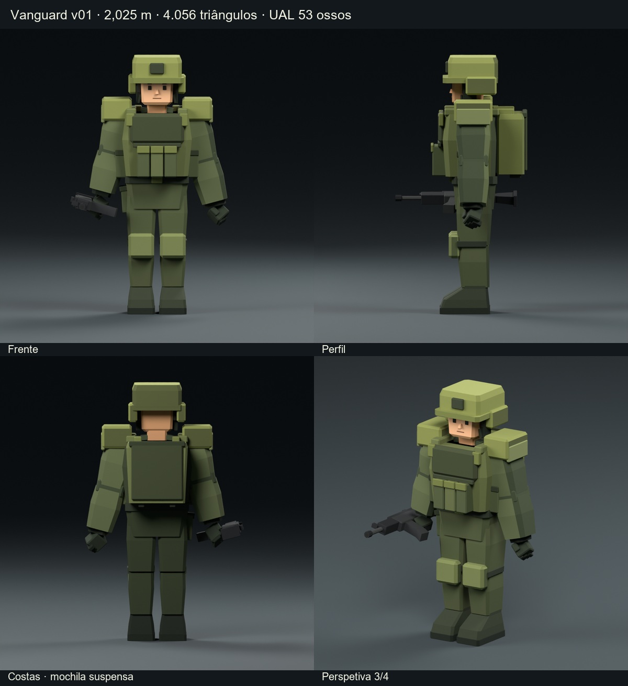
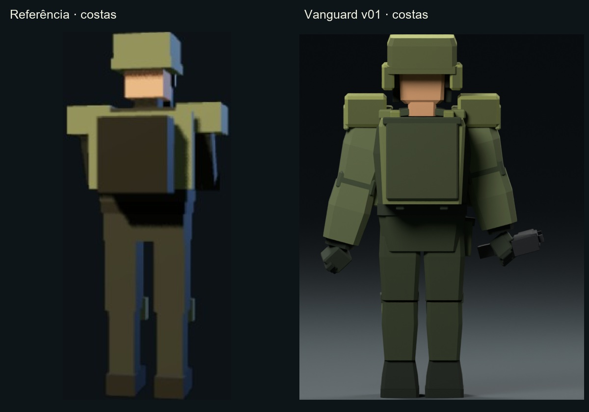
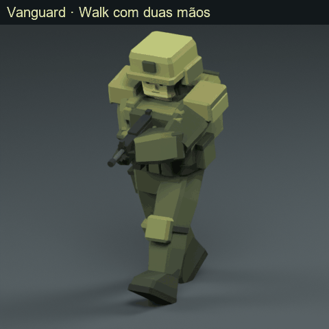

# Horde Braker — Vanguard v01

Vanguard criado a partir do Recruit aprovado, com autorização para derivar o rosto e a frente. Foram **reconstruídas 55 peças**, mantendo 104 componentes rígidos, 35 materiais de cor lisa e exatamente os 53 ossos UAL. A referência fornecida mostra apenas as costas; a frente é uma interpretação aprovada pelo utilizador, não uma vista documentada do Vanguard original.

## Alterações de geometria e visual

1. **Capacete:** copa nova mais quadrada, topo chanfrado, aba larga, placa frontal e proteções laterais reconstruídas. Altura total exata de 2,025 m, igual ao Recruit; rosto, nariz, olhos, sobrancelhas e boca aprovados preservados.
2. **Armadura:** ombreiras em placas largas, colete com seção e espessura maiores, placa peitoral reconstruída, alças reforçadas e bolsas frontais mais compactas. As ombreiras usam os ossos das clavículas para permanecerem sobre os ombros com os braços baixos.
3. **Mochila:** volume retangular suspenso por duas ligações superiores, moldura verde-oliva, painel traseiro escuro e apoios inferiores discretos. A antiga peça `Backpack_Rear_Pocket` foi convertida num painel plano, conservando o nome de componente para continuidade. Não foram acrescentados gadgets, antenas, armas novas ou acessórios sem base na referência.
4. **Uniforme e proteção:** tronco, bacia, mangas, antebraços, coxas, canelas, joelheiras e botas reconstruídos com planos e chanfros low-poly. As mãos e o equipamento de apoio herdado do Recruit mantêm-se separados.
5. **Cores:** paleta verde-oliva com contrastes escuros, interpretada a partir da captura fornecida. Tons da pele, cabelo e arma preservados; zero texturas, subdivisões ou suavização das faces.

## Entrega e utilização no Godot

- `Horde_Braker_Vanguard_v01_rigged.blend`: modelo editável, componentes individuais, armature, ações auxiliares e estúdio de renderização.
- `Horde_Braker_Vanguard_v01_rigged.glb`: personagem, arma substituível, skin e 53 ossos; sem animações, chão, câmaras ou luzes.
- `Vanguard_UAL_compatible.tres`: 46 clips externos, adaptados automaticamente a este rest; `Vanguard_v01.tscn` já tem a biblioteca e o apoio de duas mãos configurados.
- `Vanguard_v01_previews`: quatro vistas principais, três vistas em T-pose, detalhe das costas em 3/4, pose de empunhadura, frames de Idle/Walk/Sprint, quatro GIFs e comparação com a referência.
- Scripts Python/GDScript e relatórios JSON de validação incluídos. Os ficheiros de origem do Recruit e da UAL foram preservados por SHA-256.

**Próximo passo:** copie o GLB, `Vanguard_v01.tscn`, `Vanguard_UAL_compatible.tres`, `Vanguard_UAL_loader.gd`, `Vanguard_Rifle_Hold.gd` e `Vanguard_Rifle_Hold_pose.json` para a mesma pasta no projeto Godot e instancie `Vanguard_v01.tscn` na cena do jogo. O contentor inicia Idle e o apoio de duas mãos; não contém controlador de movimento, colisões nem câmara.

Para mudar de clip, chame `play_ual("Walk_Loop")` ou `play_ual("Sprint_Loop")` no nó raiz do contentor. Desative `use_rifle_hold` para usar o balanço genérico dos braços. Se integrar o GLB diretamente, associe o carregador a um nó da instância e atribua a biblioteca externa no Inspector; não há mapeamento manual de ossos.

## Esqueleto, escala e arma

O rig mantém **exatamente o mesmo rest do Recruit**, incluindo nomes, pais, posições e orientações dos 53 ossos. Unidades em metros, +Y vertical no Godot, frente -Z, origem e solas em Y=0 na pose base. A altura real de ambos é 2,025 m, apresentada arredondada como 2,03 m. A pose base é T-pose, verificada na biblioteca original. A rotação fixa de 180° no contentor `Rig` corrige a frente da biblioteca sem modificar os eixos locais; conserve-a.

Cada peça tem uma única influência de peso 1,0. Os ossos dos dedos são preservados, mas as luvas rígidas seguem a mão inteira. A biblioteca original contém canais absolutos de posição: use a cópia externa adaptada, pois aplicar todos os canais brutos pode restaurar as proporções originais da UAL. A adaptação é automática, sem mapeamento manual, e a biblioteca original permanece intacta.

A Assault Rifle existente foi mantida como **arma provisória substituível**; não foi criada uma Machine Gun nem os cinco modelos futuros. Todas as peças `Rifle_*` seguem `DEF-hand.R`. `Muzzle` é um nó independente na ponta do cano, com -Z local como direção do disparo e sem acrescentar um osso. Na T-pose, a arma acompanha a mão direita; o apoio esquerdo é fornecido pela sobreposição opcional de oito ossos do braço.

## Validação técnica

| Verificação | Resultado |
|---|---|
| Blender | 5.2.2 LTS |
| Godot real | 4.7.2-stable (official) |
| Altura do GLB | 2.025000197 m |
| Meshes / ossos / materiais | 104 / 53 / 35 |
| Triângulos | 4056 |
| Vértices no GLB | 8524 (normais planas duplicam vértices) |
| Peças com nova topologia | 55 |
| Nomes e pais dos ossos | 53/53, correspondência exata ao JSON |
| Diferença de rest relativamente ao Recruit | 0.0 |
| Topologia editável | Peças fechadas, manifold, volumes positivos, faces não degeneradas |
| Pesos | Um único osso por peça, peso 1,0 por vértice |
| Animações / texturas no GLB | 0 / 0 |
| Paleta | 35 materiais; tons oliva e cores da pele/arma verificados |
| Erro de matrizes de bind | 4.06e-07 |
| Clips testados no motor | 46; 266 amostras |
| Idle / Walk / Sprint | 17 amostras por clip, mais teste da empunhadura |
| Erro máximo de escala em animação | 2.03e-06 |
| Erro da ligação do Muzzle | 5.54e-07 m |
| Erro do apoio da mão esquerda | 6.78e-07 m |
| Cena importada pelo editor | Carregada e executada; Idle iniciado |
| Originais | Hashes SHA-256 preservados |

Foram verificadas as matrizes de bind, a hierarquia, os nomes, os pesos, índices, áreas de triângulos, cores e dimensões no GLB. No Godot, foram avaliadas poses finitas, ausência de escalas indesejadas, ligação da arma e apoio esquerdo. Os testes numéricos dos 46 clips não equivalem a uma inspeção artística de todos os seus fotogramas. As vistas principais e amostras dos ciclos foram comparadas visualmente.

## Diferenças e limites que subsistem

- A referência é uma captura pequena, traseira, iluminada pelo jogo. A frente, as espessuras, os chanfros e os detalhes não visíveis foram interpretados a partir do Recruit com autorização; não se afirma uma correspondência exata com vistas inexistentes.
- A silhueta mantém a mesma altura e o equipamento militar, mas tem detalhes adicionais de geometria herdados do Recruit e armadura mais volumosa do que a representação muito simples da captura. A mochila conserva o painel traseiro simples, sem a bolsa saliente do Recruit.
- O skinning é rígido por pedido: não há deformação suave, articulação individual dos dedos ou expressões faciais. Flexões fortes podem revelar juntas ou interseções; armadura e colete volumosos podem tocar nos braços em alguns movimentos.
- O apoio de duas mãos é uma pose fixa relativa ao tronco, não IK de mira global. O cano acompanha a inclinação do corpo. Novas armas podem precisar de offsets próprios de pega e apoio. Não foram implementados IK de pés, gameplay, colisões ou lógica da habilidade War Cry.
- `Run_Sprint` mostra o clip `Sprint_Loop`, porque a biblioteca não tem um clip chamado `Run`. A integração foi testada no Godot 4.7.2; a sobreposição opcional usa `SkeletonModifier3D`, indisponível em algumas versões antigas de Godot 4.

## Repetir a construção

Mantenha na pasta os ficheiros aprovados do Recruit v03, os seus auxiliares de animação, os scripts de renderização e a biblioteca UAL original. `build_vanguard_v01.py` cria a geometria com bpy/bmesh e salva apenas nomes Vanguard. `prepare_vanguard_support.py` prepara cópias independentes da integração. O JSON do esqueleto está incluído em `vanguard_v01_work/UAL_skeleton_reference.json`. Os scripts param se a estrutura ou os critérios técnicos não corresponderem ao esperado.

```powershell
python .\prepare_vanguard_support.py
& "C:\Program Files\Blender Foundation\Blender 5.2\blender.exe" --background --factory-startup --python .\build_vanguard_v01.py
& "C:\Program Files\Blender Foundation\Blender 5.2\blender.exe" --background --factory-startup --threads 8 --python .\render_vanguard_v01.py -- --with-motion
python .\validate_vanguard_v01.py
& "CAMINHO\godot_console.exe" --headless --path .\vanguard_v01_work\godot_validation --script res://validate_ual.gd -- "C:/CAMINHO/PASTA_DO_MODELO"
```

Para repetir o teste da cena importada, copie os seis ficheiros de integração para `vanguard_v01_work/godot_validation/demo`, execute Godot com `--headless --editor --import --path ... --quit` e depois `--headless --path ... --script res://validate_demo.gd`. Para regenerar o relatório, os GIFs e o ZIP, execute `python package_vanguard_v01.py` após esses testes. O Python externo precisa de numpy e Pillow; o Blender usa apenas módulos integrados. Uma nova execução substitui os entregáveis Vanguard v01, nunca os originais do Recruit. O pacote não duplica os executáveis do Blender/Godot nem os ficheiros de origem.

## Tabela completa: peça → osso

| Peça | Osso | Peso | Geometria | Materiais |
|---|---|---:|---|---|
| `Arm_Elbow_L` | `DEF-forearm.L` | 1,0 | Reconstruída | VG_cloth_dark |
| `Arm_Elbow_R` | `DEF-forearm.R` | 1,0 | Reconstruída | VG_cloth_dark |
| `Arm_Forearm_L` | `DEF-forearm.L` | 1,0 | Reconstruída | VG_cloth, VG_cloth_dark |
| `Arm_Forearm_R` | `DEF-forearm.R` | 1,0 | Reconstruída | VG_cloth, VG_cloth_dark |
| `Arm_Shoulder_Facet_L` | `DEF-shoulder.L` | 1,0 | Reconstruída | VG_helmet, VG_helmet_shadow |
| `Arm_Shoulder_Facet_R` | `DEF-shoulder.R` | 1,0 | Reconstruída | VG_helmet, VG_helmet_shadow |
| `Arm_Upper_L` | `DEF-upper_arm.L` | 1,0 | Reconstruída | VG_cloth, VG_cloth_dark |
| `Arm_Upper_Patch_L` | `DEF-shoulder.L` | 1,0 | Reconstruída | VG_cloth_light |
| `Arm_Upper_Patch_R` | `DEF-shoulder.R` | 1,0 | Reconstruída | VG_cloth_light |
| `Arm_Upper_R` | `DEF-upper_arm.R` | 1,0 | Reconstruída | VG_cloth, VG_cloth_dark |
| `Backpack_Flap` | `DEF-spine.003` | 1,0 | Reconstruída | VG_pouch_flap |
| `Backpack_Main` | `DEF-spine.003` | 1,0 | Reconstruída | VG_helmet_trim, VG_vest |
| `Backpack_Rear_Pocket` | `DEF-spine.003` | 1,0 | Reconstruída | VG_plate |
| `Backpack_Retention_L` | `DEF-spine.003` | 1,0 | Reconstruída | VG_vest_strap |
| `Backpack_Retention_R` | `DEF-spine.003` | 1,0 | Reconstruída | VG_vest_strap |
| `Backpack_Shoulder_Strap_L` | `DEF-spine.003` | 1,0 | Reconstruída | VG_helmet_trim |
| `Backpack_Shoulder_Strap_R` | `DEF-spine.003` | 1,0 | Reconstruída | VG_helmet_trim |
| `Belt_Buckle` | `DEF-hips` | 1,0 | Reconstruída | VG_helmet_trim |
| `Boot_L_Shaft` | `DEF-foot.L` | 1,0 | Reconstruída | VG_boot, VG_boot_shadow |
| `Boot_L_Sole` | `DEF-foot.L` | 1,0 | Reconstruída | VG_sole |
| `Boot_L_Vamp` | `DEF-foot.L` | 1,0 | Reconstruída | VG_boot, VG_boot_shadow, VG_boot_light |
| `Boot_R_Shaft` | `DEF-foot.R` | 1,0 | Reconstruída | VG_boot, VG_boot_shadow |
| `Boot_R_Sole` | `DEF-foot.R` | 1,0 | Reconstruída | VG_sole |
| `Boot_R_Vamp` | `DEF-foot.R` | 1,0 | Reconstruída | VG_boot, VG_boot_shadow, VG_boot_light |
| `Face_Brow_L` | `DEF-head` | 1,0 | Herdada | VG_brow |
| `Face_Brow_R` | `DEF-head` | 1,0 | Herdada | VG_brow |
| `Face_Eye_L` | `DEF-head` | 1,0 | Herdada | VG_eyes |
| `Face_Eye_R` | `DEF-head` | 1,0 | Herdada | VG_eyes |
| `Face_Mouth_Neutral` | `DEF-head` | 1,0 | Herdada | VG_mouth |
| `Face_Nose` | `DEF-head` | 1,0 | Herdada | VG_nose, VG_skin |
| `Glove_Cuff_L` | `DEF-forearm.L` | 1,0 | Herdada | VG_glove_shadow |
| `Glove_Cuff_R` | `DEF-forearm.R` | 1,0 | Herdada | VG_glove_shadow |
| `Glove_L_Finger_01` | `DEF-hand.L` | 1,0 | Herdada | VG_glove_shadow |
| `Glove_L_Finger_02` | `DEF-hand.L` | 1,0 | Herdada | VG_glove_shadow |
| `Glove_L_Finger_03` | `DEF-hand.L` | 1,0 | Herdada | VG_glove_shadow |
| `Glove_L_Palm` | `DEF-hand.L` | 1,0 | Herdada | VG_glove |
| `Glove_L_Thumb` | `DEF-hand.L` | 1,0 | Herdada | VG_glove |
| `Glove_R_Finger_01` | `DEF-hand.R` | 1,0 | Herdada | VG_glove_shadow |
| `Glove_R_Finger_02` | `DEF-hand.R` | 1,0 | Herdada | VG_glove_shadow |
| `Glove_R_Finger_03` | `DEF-hand.R` | 1,0 | Herdada | VG_glove_shadow |
| `Glove_R_Palm` | `DEF-hand.R` | 1,0 | Herdada | VG_glove |
| `Glove_R_Thumb` | `DEF-hand.R` | 1,0 | Herdada | VG_glove |
| `Head_Ear_L` | `DEF-head` | 1,0 | Herdada | VG_skin_shadow |
| `Head_Ear_R` | `DEF-head` | 1,0 | Herdada | VG_skin_shadow |
| `Head_Face_Skin` | `DEF-head` | 1,0 | Herdada | VG_skin, VG_skin_shadow |
| `Head_Sideburn_L` | `DEF-head` | 1,0 | Herdada | VG_hair |
| `Head_Sideburn_R` | `DEF-head` | 1,0 | Herdada | VG_hair |
| `Helmet_Brim` | `DEF-head` | 1,0 | Reconstruída | VG_helmet_trim, VG_helmet_shadow, VG_helmet |
| `Helmet_Chinstrap_L` | `DEF-head` | 1,0 | Herdada | VG_vest_strap |
| `Helmet_Chinstrap_R` | `DEF-head` | 1,0 | Herdada | VG_vest_strap |
| `Helmet_Crown` | `DEF-head` | 1,0 | Reconstruída | VG_helmet, VG_helmet_shadow, VG_helmet_top |
| `Helmet_Ear_Protection_L` | `DEF-head` | 1,0 | Herdada | VG_glove_shadow |
| `Helmet_Ear_Protection_R` | `DEF-head` | 1,0 | Herdada | VG_glove_shadow |
| `Helmet_Front_Plate` | `DEF-head` | 1,0 | Reconstruída | VG_helmet_patch |
| `Helmet_Side_Shield_L` | `DEF-head` | 1,0 | Reconstruída | VG_helmet, VG_helmet_shadow |
| `Helmet_Side_Shield_R` | `DEF-head` | 1,0 | Reconstruída | VG_helmet, VG_helmet_shadow |
| `Knee_Strap_L` | `DEF-shin.L` | 1,0 | Herdada | VG_vest_strap |
| `Knee_Strap_R` | `DEF-shin.R` | 1,0 | Herdada | VG_vest_strap |
| `Kneepad_L` | `DEF-shin.L` | 1,0 | Reconstruída | VG_knee, VG_knee_shadow |
| `Kneepad_R` | `DEF-shin.R` | 1,0 | Reconstruída | VG_knee, VG_knee_shadow |
| `Leg_Shin_L` | `DEF-shin.L` | 1,0 | Reconstruída | VG_pants, VG_pants_shadow |
| `Leg_Shin_R` | `DEF-shin.R` | 1,0 | Reconstruída | VG_pants, VG_pants_shadow |
| `Leg_Thigh_L` | `DEF-thigh.L` | 1,0 | Reconstruída | VG_pants, VG_pants_shadow |
| `Leg_Thigh_R` | `DEF-thigh.R` | 1,0 | Reconstruída | VG_pants, VG_pants_shadow |
| `Neck_Skin` | `DEF-neck` | 1,0 | Herdada | VG_skin_shadow |
| `Rifle_Barrel` | `DEF-hand.R` | 1,0 | Herdada | VG_metal_light |
| `Rifle_Front_Sight` | `DEF-hand.R` | 1,0 | Herdada | VG_metal_dark |
| `Rifle_Handguard` | `DEF-hand.R` | 1,0 | Herdada | VG_metal_dark |
| `Rifle_Magazine` | `DEF-hand.R` | 1,0 | Herdada | VG_metal |
| `Rifle_Muzzle` | `DEF-hand.R` | 1,0 | Herdada | VG_metal_dark |
| `Rifle_Muzzle_Bore` | `DEF-hand.R` | 1,0 | Herdada | VG_eyes |
| `Rifle_Pistol_Grip` | `DEF-hand.R` | 1,0 | Herdada | VG_metal_dark |
| `Rifle_Rear_Sight` | `DEF-hand.R` | 1,0 | Herdada | VG_metal_dark |
| `Rifle_Receiver` | `DEF-hand.R` | 1,0 | Herdada | VG_metal |
| `Rifle_Stock` | `DEF-hand.R` | 1,0 | Herdada | VG_metal_dark |
| `Rifle_Stock_Butt` | `DEF-hand.R` | 1,0 | Herdada | VG_metal_dark |
| `Rifle_Stock_Neck` | `DEF-hand.R` | 1,0 | Herdada | VG_metal_dark |
| `Rifle_Trigger_Guard_Base` | `DEF-hand.R` | 1,0 | Herdada | VG_metal_dark |
| `Rifle_Trigger_Guard_Front` | `DEF-hand.R` | 1,0 | Herdada | VG_metal_dark |
| `Rifle_Upper_Receiver` | `DEF-hand.R` | 1,0 | Herdada | VG_metal_dark |
| `Thigh_Utility_Flap_R` | `DEF-thigh.R` | 1,0 | Herdada | VG_pouch_flap |
| `Thigh_Utility_Pouch_R` | `DEF-thigh.R` | 1,0 | Herdada | VG_pouch |
| `Uniform_Belt` | `DEF-hips` | 1,0 | Reconstruída | VG_vest_strap |
| `Uniform_Collar_L` | `DEF-neck` | 1,0 | Herdada | VG_cloth_dark |
| `Uniform_Collar_R` | `DEF-neck` | 1,0 | Herdada | VG_cloth_dark |
| `Uniform_Pelvis` | `DEF-hips` | 1,0 | Reconstruída | VG_pants, VG_pants_shadow |
| `Uniform_Torso` | `DEF-spine.002` | 1,0 | Reconstruída | VG_cloth, VG_cloth_dark |
| `Vest_Carrier` | `DEF-spine.003` | 1,0 | Reconstruída | VG_vest, VG_vest_shadow |
| `Vest_Chest_Plate` | `DEF-spine.003` | 1,0 | Reconstruída | VG_plate, VG_vest_shadow |
| `Vest_Front_Strap_L` | `DEF-spine.003` | 1,0 | Reconstruída | VG_helmet_trim |
| `Vest_Front_Strap_R` | `DEF-spine.003` | 1,0 | Reconstruída | VG_helmet_trim |
| `Vest_Magazine_Flap_01` | `DEF-spine.003` | 1,0 | Reconstruída | VG_helmet_trim |
| `Vest_Magazine_Flap_02` | `DEF-spine.003` | 1,0 | Reconstruída | VG_helmet_trim |
| `Vest_Magazine_Flap_03` | `DEF-spine.003` | 1,0 | Reconstruída | VG_helmet_trim |
| `Vest_Magazine_Pouch_01` | `DEF-spine.003` | 1,0 | Reconstruída | VG_pouch |
| `Vest_Magazine_Pouch_02` | `DEF-spine.003` | 1,0 | Reconstruída | VG_pouch_light |
| `Vest_Magazine_Pouch_03` | `DEF-spine.003` | 1,0 | Reconstruída | VG_pouch |
| `Vest_Shoulder_Strap_L` | `DEF-spine.003` | 1,0 | Reconstruída | VG_vest |
| `Vest_Shoulder_Strap_R` | `DEF-spine.003` | 1,0 | Reconstruída | VG_vest |
| `Vest_Side_Pouch_Flap_L` | `DEF-spine.003` | 1,0 | Reconstruída | VG_pouch_flap |
| `Vest_Side_Pouch_Flap_R` | `DEF-spine.003` | 1,0 | Reconstruída | VG_pouch_flap |
| `Vest_Side_Pouch_L` | `DEF-spine.003` | 1,0 | Reconstruída | VG_pouch |
| `Vest_Side_Pouch_R` | `DEF-spine.003` | 1,0 | Reconstruída | VG_pouch |
| `Vest_Upper_Webbing` | `DEF-spine.003` | 1,0 | Reconstruída | VG_vest_shadow |

## Posições finais dos 53 ossos

Cabeças dos ossos em coordenadas globais do Godot, em metros, incluindo a orientação do contentor. +Y vertical; -Z frente. Extremos e dados completos constam de `vanguard_v01_work/rig_validation.json`.

| Osso | Pai | X | Y | Z |
|---|---|---:|---:|---:|
| `root` | `` | 0.000000 | 0.000000 | -0.000000 |
| `DEF-hips` | `root` | 0.000000 | 0.999844 | 0.030375 |
| `DEF-spine.001` | `DEF-hips` | 0.000000 | 1.151719 | 0.030375 |
| `DEF-spine.002` | `DEF-spine.001` | 0.000000 | 1.335234 | 0.030375 |
| `DEF-spine.003` | `DEF-spine.002` | 0.000000 | 1.480781 | 0.030375 |
| `DEF-neck` | `DEF-spine.003` | 0.000000 | 1.590891 | 0.010125 |
| `DEF-head` | `DEF-neck` | 0.000000 | 1.652906 | -0.000000 |
| `DEF-shoulder.L` | `DEF-spine.003` | -0.094922 | 1.575703 | 0.031641 |
| `DEF-upper_arm.L` | `DEF-shoulder.L` | -0.275906 | 1.551656 | 0.015188 |
| `DEF-forearm.L` | `DEF-upper_arm.L` | -0.638470 | 1.551656 | 0.021398 |
| `DEF-hand.L` | `DEF-forearm.L` | -0.991749 | 1.551656 | 0.015307 |
| `DEF-f_index.01.L` | `DEF-hand.L` | -1.061291 | 1.550496 | -0.002615 |
| `DEF-f_index.02.L` | `DEF-f_index.01.L` | -1.084897 | 1.550496 | -0.002615 |
| `DEF-f_index.03.L` | `DEF-f_index.02.L` | -1.105080 | 1.550496 | -0.002615 |
| `DEF-f_middle.01.L` | `DEF-hand.L` | -1.062277 | 1.551889 | 0.012291 |
| `DEF-f_middle.02.L` | `DEF-f_middle.01.L` | -1.086811 | 1.551889 | 0.013451 |
| `DEF-f_middle.03.L` | `DEF-f_middle.02.L` | -1.106473 | 1.551889 | 0.014321 |
| `DEF-f_pinky.01.L` | `DEF-hand.L` | -1.054214 | 1.550729 | 0.038971 |
| `DEF-f_pinky.02.L` | `DEF-f_pinky.01.L` | -1.077530 | 1.550729 | 0.040537 |
| `DEF-f_pinky.03.L` | `DEF-f_pinky.02.L` | -1.093538 | 1.550729 | 0.041639 |
| `DEF-f_ring.01.L` | `DEF-hand.L` | -1.060826 | 1.551714 | 0.025225 |
| `DEF-f_ring.02.L` | `DEF-f_ring.01.L` | -1.083621 | 1.551714 | 0.026037 |
| `DEF-f_ring.03.L` | `DEF-f_ring.02.L` | -1.101542 | 1.551715 | 0.026675 |
| `DEF-thumb.01.L` | `DEF-hand.L` | -1.007583 | 1.538432 | -0.004181 |
| `DEF-thumb.02.L` | `DEF-thumb.01.L` | -1.027418 | 1.527297 | -0.014447 |
| `DEF-thumb.03.L` | `DEF-thumb.02.L` | -1.050038 | 1.514595 | -0.026163 |
| `DEF-shoulder.R` | `DEF-spine.003` | 0.094922 | 1.575703 | 0.031641 |
| `DEF-upper_arm.R` | `DEF-shoulder.R` | 0.275906 | 1.551656 | 0.015188 |
| `DEF-forearm.R` | `DEF-upper_arm.R` | 0.571849 | 1.551656 | 0.020256 |
| `DEF-hand.R` | `DEF-forearm.R` | 0.904218 | 1.551656 | 0.014526 |
| `DEF-f_index.01.R` | `DEF-hand.R` | 0.973760 | 1.550496 | -0.003396 |
| `DEF-f_index.02.R` | `DEF-f_index.01.R` | 0.997366 | 1.550496 | -0.003396 |
| `DEF-f_index.03.R` | `DEF-f_index.02.R` | 1.017550 | 1.550496 | -0.003396 |
| `DEF-f_middle.01.R` | `DEF-hand.R` | 0.974746 | 1.551888 | 0.011510 |
| `DEF-f_middle.02.R` | `DEF-f_middle.01.R` | 0.999280 | 1.551888 | 0.012670 |
| `DEF-f_middle.03.R` | `DEF-f_middle.02.R` | 1.018942 | 1.551888 | 0.013540 |
| `DEF-f_pinky.01.R` | `DEF-hand.R` | 0.966684 | 1.550728 | 0.038190 |
| `DEF-f_pinky.02.R` | `DEF-f_pinky.01.R` | 0.990000 | 1.550728 | 0.039756 |
| `DEF-f_pinky.03.R` | `DEF-f_pinky.02.R` | 1.006008 | 1.550728 | 0.040858 |
| `DEF-f_ring.01.R` | `DEF-hand.R` | 0.973296 | 1.551714 | 0.024444 |
| `DEF-f_ring.02.R` | `DEF-f_ring.01.R` | 0.996090 | 1.551714 | 0.025256 |
| `DEF-f_ring.03.R` | `DEF-f_ring.02.R` | 1.014012 | 1.551714 | 0.025894 |
| `DEF-thumb.01.R` | `DEF-hand.R` | 0.920052 | 1.538432 | -0.004962 |
| `DEF-thumb.02.R` | `DEF-thumb.01.R` | 0.939888 | 1.527296 | -0.015228 |
| `DEF-thumb.03.R` | `DEF-thumb.02.R` | 0.962508 | 1.514594 | -0.026944 |
| `DEF-thigh.L` | `DEF-hips` | -0.125297 | 0.960609 | 0.021516 |
| `DEF-shin.L` | `DEF-thigh.L` | -0.125297 | 0.553078 | 0.006328 |
| `DEF-foot.L` | `DEF-shin.L` | -0.125297 | 0.221484 | 0.031641 |
| `DEF-toe.L` | `DEF-foot.L` | -0.125297 | 0.037969 | -0.183516 |
| `DEF-thigh.R` | `DEF-hips` | 0.125297 | 0.960609 | 0.021516 |
| `DEF-shin.R` | `DEF-thigh.R` | 0.125297 | 0.553078 | 0.006328 |
| `DEF-foot.R` | `DEF-shin.R` | 0.125297 | 0.221484 | 0.031641 |
| `DEF-toe.R` | `DEF-foot.R` | 0.125297 | 0.037969 | -0.183516 |

## Comparação visual







## Integridade dos originais

- `Horde_Braker_Recruit_v03_rigged.blend`: `f2ea655defd744d626b72a8d3330e1c95e24bd0e33a6e7b3dee799876c88a9c8`
- `Horde_Braker_Recruit_v03_rigged.glb`: `2a9d61ca90977f6dc0da5f09cea1de9892d630a2cf25862e909515fbe6b08cf3`
- `Recruit_UAL_compatible.tres`: `73fad518444978dbf35dbc73f217901637e42d1c79cb3b2dcf5860732406ff61`
- `Recruit_Rifle_Hold_pose.json`: `3218eb21c738bed2cbfd6f53c7005b029f99ac8803697f0720d81292a0da286e`
- `AnimationLibrary_Godot_Standard.glb`: `1b7bf67866360665426bb99e4c71bd619f19b408453c24e30f0c3071601eee5c`
