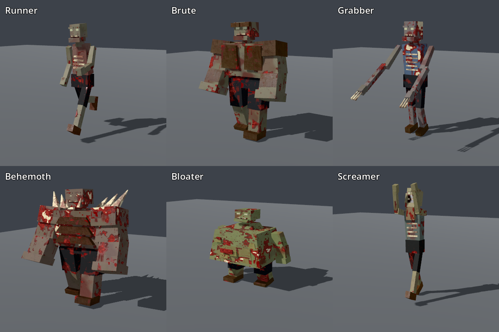

# Modelos dos inimigos especiais

Os seis tipos que ainda usavam cápsulas têm agora geometria original e
perfis de movimento próprios, integrados na ilha pelo `ZombieHordeView`.
Mantêm o estilo em blocos dos zombies comuns, materiais PBR e gore.
As regras de IA, velocidades, vida, dano, colisões e alvos de tiro mantêm-se.



| Inimigo | Silhueta e anatomia | Movimento visual | Triângulos |
|---|---|---|---:|
| Runner | Magro, peito estreito, costelas e roupa rasgada, cabeça pequena | Passada rápida, braços alternados, tronco inclinado | 396 |
| Brute | Tronco largo, ombreiras, proteção frontal, punhos e antebraços grandes | Passo curto e pesado; braços baixos | 432 |
| Grabber | Alto e esguio, braços muito longos, dedos ósseos, crânio alongado | Braços projetados à frente, alcance maior ao atacar | 468 |
| Behemoth | Massa de boss, carapaça frontal, ombros enormes, espinhos, presas, ferida nas costas | Movimento pesado e menor balanço; queda com o próprio modelo | 504 |
| Bloater | Ventre largo e distendido, pernas curtas, nódulos e ferida abdominal | Passos curtos e balanço lateral | 480 |
| Screamer | Corpo fino, garganta saliente, maxilar aberto e boca vertical | Braços elevados junto à cabeça | 420 |

[Comparação animada](../design/art/specials_models.gif), com os modelos
reais desenhados pelo Godot. A grelha aproxima cada câmara para permitir
inspecionar detalhes; não serve para comparar alturas. A imagem
`specials_lineup.png` mostra os sete tipos na mesma escala.

## Implementação

- `game/world/special_enemy_model.gd`: peças e proporções independentes por
  tipo, com malha partilhada entre instâncias. O código é a fonte editável
  dos modelos; não existem ficheiros Blender novos nesta etapa.
- `ZombieModel.build_parts`: reutiliza o formato de vértices dos zombies,
  UV em metros, normais, tangentes e separação por material. Acrescenta
  peças afuniladas e rodadas, usadas nos espinhos, presas e musculatura.
  Os quatro modelos do Walker conservam a geometria anterior.
- `zombie.gdshader`: pivôs configuráveis por modelo e seis perfis de pose.
  Os materiais dos especiais são cópias dos materiais existentes, com as
  mesmas texturas CC0 já registadas em `assets/LICENSES.md`. O shader dos
  comuns mantém os seus valores por defeito.
- `ZombieHordeView`: quatro grupos dos comuns mais seis dos especiais.
  O tipo determina a malha mesmo se dois inimigos tiverem a mesma
  velocidade-base. Mantém estados de impacto, frio, veneno, queimadura,
  atordoamento, congelamento e cadáveres. Em mortes sobrepostas, a procura
  do aspeto anterior filtra o tipo para não usar o modelo de um vizinho.
- O centro do crânio na malha em repouso é alinhado com
  `IslandRun.enemy_head`, incluindo o deslocamento proporcional ao raio.
  As animações podem desviar visualmente a cabeça desse centro, como nos
  zombies comuns; não alteram o alvo da simulação.
- Uma caixa de visibilidade dos especiais inclui os braços estendidos e
  os corpos caídos, porque a animação é feita no shader.

## Verificação e reprodução

`tests/test_special_models.gd` verifica cobertura dos sete tipos, seis
geometrias diferentes, triângulos não degenerados, UV/normais/tangentes,
seleção por tipo com velocidades iguais, congelamento, compactação,
cadáveres, mortes sobrepostas e alinhamento do crânio com o alvo real.
Carrega também a cena real da ilha. Com GPU confirma que as sete cápsulas
estão escondidas; o backend headless não conserva essas transformações
e não é usado para essa conclusão.

```text
godot --headless --path . --script res://tests/test_special_models.gd
godot --path . --script res://tests/test_special_models.gd
godot --path . --script res://tools/dev/special_enemy_preview.gd -- <pasta de fotogramas>
godot --path . --script res://tools/dev/zombie_preview.gd -- <png> specials
godot --path . --script res://tools/dev/zombie_preview.gd -- <png> specials_back
godot --path . --script res://tools/dev/zombie_preview.gd -- <png> bench_specials
```

Os testes dos zombies comuns e das armas passam a exigir os Brutes com
modelo próprio, incluindo os cadáveres. Mantêm os limites anteriores de
animação e desempenho. Os resultados compactos ficam em
`special_enemy_validation.json`.

Resultado final: **47/49 scripts** passaram, incluindo os testes de
modelos, armas, câmaras, empunhadura, animação e as duas runs completas
de três ilhas. O teste novo passou 49 verificações em headless e 50 com
GPU. Permanecem as falhas já conhecidas de `test_escort` (seed 505) e
`test_intel_search` (proporção de rotas Town).

Na primeira execução, `test_fuel_run` encontrou um erro de compilação
relativo ao FOV após alterações nos ficheiros de câmara durante a suite.
A repetição isolada passou em 97,5 s; os hashes de `profile.gd` e
`island.gd` mantiveram-se iguais durante essa repetição. O relatório conserva
o erro da primeira execução e o resultado da repetição, sem ocultar a falha.

Ensaio visual em Forward+, RTX 5060, 1600×900, 150 inimigos mistos
(incluindo um Behemoth), média de 500 fotogramas após aquecimento, vsync
desligado: **1,153 ms de GPU**, 0,289 ms de CPU do renderer e
**0,452 ms de CPU** em `ZombieHordeView.draw`. É uma cena de arte,
sem IA, terreno ou HUD da ilha; estes números não representam o custo
total do jogo. A imagem está em `docs/design/art/specials_bench.png`.

A atualização usa os formatos documentados de
[SurfaceTool](https://docs.godotengine.org/en/stable/tutorials/3d/procedural_geometry/surfacetool.html)
e [MultiMesh](https://docs.godotengine.org/en/stable/classes/class_multimesh.html).

## Ações e poses (2026-10-20)

Duas ações do jogo aparecem agora no corpo dos especiais, pelo canal `act`
(lunge) que já servia o ataque:

- **Chamada do Screamer:** no instante em que um Screamer chama a horda
  (`IslandRun.scream_age` = 0), todos os Screamers tomam a pose de chamada e
  ela desvanece em 0,8 s. A cabeça vai para trás e os braços sobem
  (`zombie.gdshader`, tipo 6: alcance +0,25 e inclinação −0,35 com o lunge).
  Capturas: `docs/design/specials_poses/screamer_close_rest.png` (repouso) e
  `screamer_close_scream.png` (chamada).
- **Carga do golpe do Behemoth:** durante a janela de carga do golpe de chão
  (`run.slam_time`, `GameData.BOSS_SLAM_WINDUP`), o Behemoth levanta os
  braços de 0 a 1 e baixa-os no impacto.

Um inimigo atordoado mantém o atordoamento: a pose de ação não sobrepõe o
`act` −1. Não alterado nesta etapa: a explosão do Bloater (não verifiquei se
já coincide com a morte) e a fase de enraivecimento do Behemoth
(`boss_enraged`), que não tem pose própria. Os valores da pose são constantes
para afinar a olho no editor.

Teste: `tests/test_special_poses.gd` (chamada no instante, desvanecimento,
atordoamento, carga do golpe e os outros tipos sem reação).

## Limites

São modelos estilizados de baixo custo, com animação por pivôs no shader,
sem esqueleto individual. Ainda não há IK dos pés dos inimigos nem ciclos
capturados, colisão por membro ou animações específicas de cada fase do
boss. A pose do Screamer identifica a classe; não representa a contagem
exata do grito. O Bloater conserva um cadáver deformável em vez de uma
simulação de rutura do corpo. A lógica dessas capacidades continua a ser
a que já existia no jogo.

A autorização de envio ao JEV dada nesta conversa abrange apenas o
carregador das armas e o ajuste do braço. Nenhum destes novos ficheiros
foi enviado ao serviço externo; esta etapa foi revista localmente.
