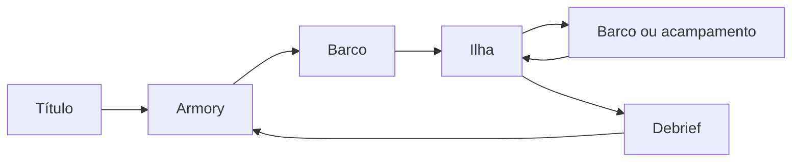

# Fluxo da run

Título → Armory → barco → ilha → barco/acampamento → continuação → debrief → Armory.

Na run normal, a documentação descreve três ilhas e o vulcão no final. Berlenga e Exfil têm regras próprias. O primeiro barco oferece duas rotas; entre ilhas há contagem de 5 s e a rota seguinte é sorteada, segundo a decisão de 2026-10-14.

Morrer termina a run e conserva Intel ganho; extrair aplica o multiplicador definido nos dados. O diagrama é um resumo conceptual, não uma listagem exata de estados de código.

Fontes: [[90 Referências/docs/DECISIONS|DECISIONS]] · [[90 Referências/game/README|README]].
Código: `game/main.gd`, `game/core/run_context.gd`, `game/states/`.
